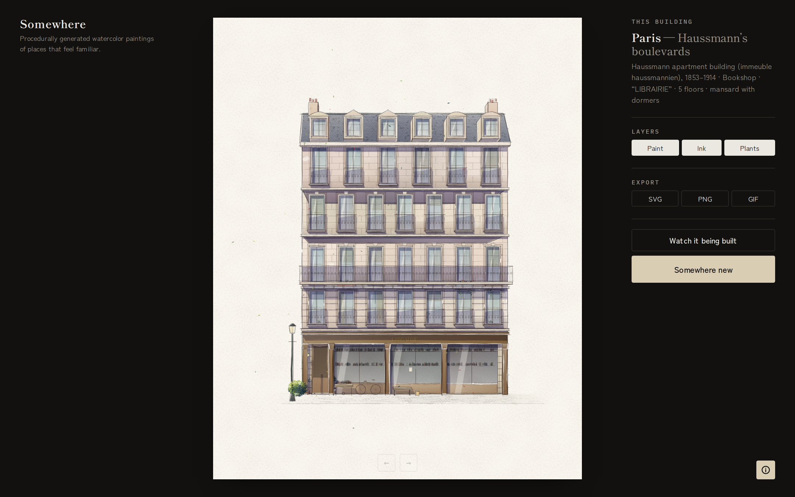

# Somewhere



Procedurally generated watercolor paintings of places that feel familiar. Every painting is a new building, designed from the architectural rules of a real place and then set out in pencil, drawn in pen and painted in watercolor, live in the browser. Sixteen places so far, from Shōwa-era Tokyo and the Straits Settlements to Lahore's Walled City and the French Quarter.

## Overview

- **Rules, not templates** — each place is a rulebook: plot widths, storey heights, materials, window types, roofs, signage script, plants and street life, with building types by period (a haveli, a tube house, a Creole cottage)
- **Dice** — every choice is a weighted roll of a seeded random generator, so a building is reproducible from its seed but no two visitors get the same one
- **Painting** — a perspective projection and a sun position; walls, windows and shadows are laid down as layered watercolor washes and wobbly pen lines, back to front, on a textured paper
- **Blueprint** — "Watch it being built" replays the real run: the dice rolls, the volumes, the camera maths, then the paint job item by item

Static site. No build step, no backend, no tracking.

## Running locally

Serve the folder and open it in a modern browser (Chrome, Safari, Firefox, Edge):

```
python3 -m http.server 8000
```

then visit http://localhost:8000. Fonts load from Google Fonts, so you'll need internet the first time.

## Features

- Sixteen places, each with its own rules, building types, scripts and languages on the signs
- Painting animation: pencil set-out, ink, brush-stroke washes, planting
- Layer toggles for paint, ink and plants
- Export as SVG (vector, sharp at any size), PNG (3300 × 4125) or GIF (the painting process)
- Blueprint mode with a live pseudo-code console showing the real values
- History of every painting in the visit, with back and forward
- Feedback and place requests from the About dialog

## Stack

- Vanilla JS / CSS, no framework, no dependencies
- Canvas 2D renderer with a recording context that turns the same drawing calls into SVG
- Paper texture as an SVG `feTurbulence` filter, with a port of the reference algorithm for canvas
- Hand-written GIF encoder (median-cut palette, LZW)
- Feedback delivered by [FormSubmit](https://formsubmit.co)
